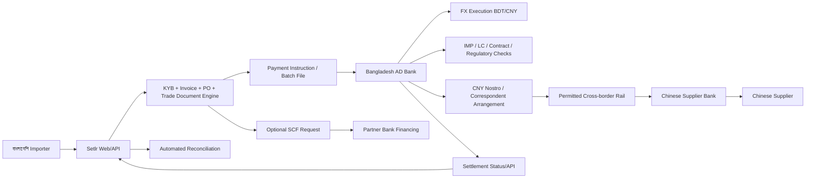
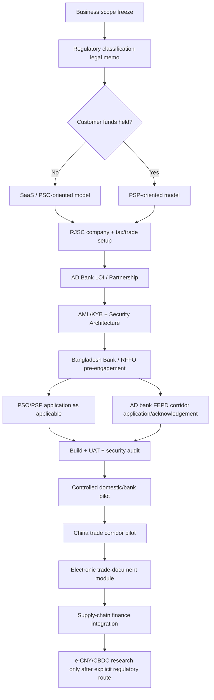

# বাংলাদেশ–চীন B2B পেমেন্ট ও CNY সেটেলমেন্ট ব্যবসা: লাইসেন্সিং, রেগুলেশন, প্রযুক্তি, বাজার ও লঞ্চ-রোডম্যাপ

## নির্বাহী সারাংশ ও বিশ্লেষণের ভিত্তি

এই প্রতিবেদনের তথ্য **২৮ সেপ্টেম্বর ২০২৬** পর্যন্ত প্রযোজ্য প্রকাশ্য আইন, বাংলাদেশ ব্যাংক, BFIU, BIDA, RJSC এবং অন্যান্য প্রাথমিক উৎসের ওপর ভিত্তি করে তৈরি। ব্যবহারকারী নির্দিষ্ট ব্যবসার নাম বা পূর্ণ business specification দেননি; তবে আপলোড করা নথিটি একটি **“Setlr”-সদৃশ China–Bangladesh B2B payment platform** বর্ণনা করে—যেখানে বাংলাদেশি importer-কে CNY-তে Chinese supplier payment, multi-supplier batch payment, reconciliation, এবং ভবিষ্যতে e-CNY/CBDC integration দেওয়ার ধারণা রয়েছে। নথিটিতে XTransfer ও WorldFirst-কে তুলনামূলক মডেল হিসেবেও উল্লেখ করা হয়েছে। fileciteturn0file0

### মূল সিদ্ধান্ত

**সবচেয়ে বাস্তবসম্মত মডেল হলো “নিজে cross-border FX/payment principal হওয়া” নয়; বরং Setlr-কে একটি regulated B2B payment/trade-orchestration layer বানিয়ে CNY settlement ও FX execution একটি Bangladesh Bank-authorized AD bank-এর মাধ্যমে করানো।** ২০২৬ সালের Bangladesh Bank-এর নতুন cross-border digital payment framework স্পষ্টভাবে বলছে—এই framework-এর cross-border settlement এবং foreign-exchange execution **exclusively Authorized Dealer (AD) bank-এর মাধ্যমে** হতে হবে। citeturn22view0turn23view0

অর্থাৎ, প্রথম দিনেই এই flow:

> Importer → **Setlr-controlled offshore CNY wallet** → China

চালু করা অত্যন্ত ঝুঁকিপূর্ণ। বরং:

> Importer → **Setlr workflow/API** → **Bangladesh AD Bank** → CNY correspondent/nostro arrangement → Chinese supplier

এই architecture-ই বর্তমানে সবচেয়ে defensible। September 23, 2026-এর FEPD-1 Circular No. 38 আরও গুরুত্বপূর্ণ: কোনো trading-partner দেশের local/non-freely-convertible currency-তে trade settlement প্রয়োজন হলে AD bank সেই currency-তে nostro রাখতে পারে, **কিন্তু Bangladesh Bank-এর prior regulatory clearance প্রয়োজন**। citeturn22view1turn23view1

এ কারণে আপলোড করা memo-তে যে “CNY sub-wallet → e-CNY → supplier” architecture কল্পনা করা হয়েছে, সেটিকে **বর্তমান অনুমোদিত operating model নয়, future-optionality/R&D hypothesis** হিসেবে দেখা উচিত। fileciteturn0file0

### আমার প্রধান সুপারিশ

| পর্যায় | সুপারিশ | Regulatory risk | পুঁজি/খরচ | মতামত |
|---|---|---:|---:|---|
| প্রথম ধাপ | **Trade/payment orchestration SaaS + AD-bank settlement** | কম–মাঝারি | ~৳২–৫ কোটি | দ্রুততম MVP |
| দ্বিতীয় ধাপ | **PSO/payment-initiation capability + AD bank** | মাঝারি | ~৳৬–১৫ কোটি | সবচেয়ে ভালো risk/reward |
| তৃতীয় ধাপ | **Full PSP/e-wallet + AD-bank cross-border leg** | উচ্চ | ~৳৩০–৬০ কোটি | scale প্রমাণের পর |
| ভবিষ্যৎ | e-CNY/CBDC corporate corridor pilot | খুব উচ্চ/অনিশ্চিত | অজানা | formal BB approval ছাড়া নয় |
| বিকল্প | Digital bank | অত্যন্ত উচ্চ | শত-কোটি টাকা | এই use case-এর জন্য overkill |

Payment and Settlement Systems Act, 2024 অনুযায়ী লাইসেন্স ছাড়া payment system পরিচালনা বা payment service দেওয়া নিষিদ্ধ; PSP গ্রাহকের aggregated balance Trust and Settlement Account-এ ধারণ করে, এবং electronic money issuance-ও regulated activity। আইন লঙ্ঘনের জন্য সর্বোচ্চ পাঁচ বছর কারাদণ্ড বা ৳৫০ লাখ জরিমানা বা উভয় দণ্ড হতে পারে। citeturn17view1turn27view0turn27view1
আইন: `https://bdlaws.minlaw.gov.bd/act-print-1496.html`

### সবচেয়ে আকর্ষণীয় সুযোগটি শুধু “cheap CNY transfer” নয়

২০২৬ সালে বাংলাদেশ ব্যাংক একই সঙ্গে তিনটি policy window খুলেছে:

1. **Bank-intermediated cross-border digital payments**; citeturn22view0
2. **Approved trade corridors-এ electronic trade documents/ETR pilot**; citeturn22view2turn23view2
3. **Supply-chain finance, documentary collection, open-account trade ও alternative trade finance**। citeturn22view3turn23view3

সুতরাং defensible business thesis হওয়া উচিত:

> **“China–Bangladesh B2B Trade Operating System”**
> invoice + KYB + trade documents + bank payment initiation + CNY settlement orchestration + reconciliation + supplier management + financing referral

শুধু “আরেকটি wallet” নয়।

## সম্ভাব্য ব্যবসার মডেল ও value proposition

### কোন সমস্যাটি সমাধান করা হচ্ছে

চীন বাংলাদেশের বৃহত্তম merchandise sourcing corridors-এর একটি। China Customs-এর official 2024 data অনুযায়ী China থেকে Bangladesh-এ goods exports ছিল প্রায় **US$22.884 billion**, আর দুই দেশের মোট goods trade ছিল প্রায় **US$24.051 billion**। ২০২৫ সালের প্রথম আট মাসেই China-এর Bangladesh-এ exports ছিল প্রায় **US$14.711 billion**। ফলে import-payment, reconciliation এবং trade-document workflow-এর জন্য underlying transaction pool যথেষ্ট বড়। citeturn19search2turn19search3

Bangladesh Bank বর্তমানে CNY-কে domestic foreign-currency clearing-এর অনুমোদিত ছয় currency-এর একটি হিসেবে অন্তর্ভুক্ত করেছে; AD banks Bangladesh Bank-এ CNY clearing account রাখতে পারে। এটি CNY-কে বাংলাদেশি regulatory architecture-এর বাইরে কোনো exotic currency নয়—এমন একটি গুরুত্বপূর্ণ signal। তবে domestic FC clearing permission নিজে থেকে cross-border CNY wallet licence তৈরি করে না। citeturn19search9
বাংলাদেশ ব্যাংক: `https://www.bb.org.bd/en/index.php/fxmarket/fc_clearing`

আপলোড করা concept memo-এর value proposition হলো USD intermediary leg কমানো, structured reconciliation, batch supplier payments এবং eventually embedded CNY/e-CNY wallet। এগুলো commercial hypothesis হিসেবে যৌক্তিক; কিন্তু memo-তে উল্লিখিত “seconds”, “near-zero cost” বা $50–150 saving-এর মতো claims bank quotes ও controlled pilot ছাড়া customer-facing guaranteed claim হিসেবে ব্যবহার করা উচিত নয়। fileciteturn0file0

### ব্যবসায়িক মডেলগুলোর তুলনা

| মডেল | Setlr কী করবে | অর্থ নিজের custody-তে? | সম্ভাব্য লাইসেন্স | China corridor fit | আমার মূল্যায়ন |
|---|---|---:|---|---|---|
| **Trade SaaS** | invoice, PO, supplier, documents, reconciliation, bank-file/API workflow | না | সাধারণত PSP নয়, যদি বাস্তবে funds transmit/custody না করে | ★★★★★ | MVP-এর জন্য সেরা |
| **Payment initiation / PSO-style** | payer instruction, bank routing, payment aggregation/orchestration | সাধারণত না/সীমিত | PSO classification সম্ভাব্য | ★★★★★ | **সেরা target model** |
| **PSP/e-wallet** | customer wallet, e-money, customer balances | হ্যাঁ | PSP | ★★★★☆ | দ্বিতীয়/তৃতীয় পর্যায় |
| **Embedded bank corridor** | Setlr UI; AD bank FX, compliance, settlement | bank custody | Setlr licence scope অনুযায়ী PSO/PSP; AD licence bank-এর | ★★★★★ | **সবচেয়ে legally robust** |
| **Supply-chain finance marketplace** | approved invoice থেকে financing request bank-এ পাঠানো | না, যদি lender না হয় | structure-dependent | ★★★★★ | উচ্চ-margin adjunct |
| **Own lending/NBFI** | importer working-capital financing | হ্যাঁ/credit risk | পৃথক finance-company/banking regime | ★★☆☆☆ | শুরুতে এড়িয়ে চলা ভালো |
| **Digital bank** | deposits, payments, FX, broader banking | হ্যাঁ | Bank Company Act + BB bank licence | ★★★☆☆ | অত্যন্ত capital-heavy |
| **Direct e-CNY corridor** | importer wallet → supplier e-CNY | সম্ভাব্য | বর্তমান clear independent route নেই | ★★★★★ future | research/pilot only |

Bangladesh Bank-এর বর্তমান payment systems page PSP-কে এমন entity হিসেবে বর্ণনা করে যে customer-facing payment service দেয়—যেমন e-wallet—আর PSO-কে bank/FI principal participant-সহ payment gateway/aggregator ধরনের operator হিসেবে বর্ণনা করে। একই page-এ বর্তমানে ২১টি authorized PSO/PSP তালিকাভুক্ত আছে এবং RFFO fintech pilot-এর জন্য regulatory facilitation দেয়। citeturn27view3
উৎস: `https://www.bb.org.bd/en/index.php/financialsystems/paysystems`

### Recommended product architecture



এই design-এর গুরুত্বপূর্ণ বৈশিষ্ট্য হচ্ছে Setlr-এর software layer customer experience ও reconciliation নিয়ন্ত্রণ করবে, কিন্তু **regulated FX principal এবং cross-border settlement agent হবে AD bank**। July 2026 framework-এ AD-এর systems-এ mirror ledger, real/near-real-time visibility, transaction controls, audit trail এবং all-settlement-through-AD requirement রয়েছে—তাই Setlr-এর API architecture-ও সেই model-এর সঙ্গে align করা উচিত। citeturn22view0turn23view0

### “Wallet” শব্দটি নিয়ে সতর্কতা

Payment and Settlement Systems Act, 2024-এ e-wallet, electronic money এবং PSP-এর সুস্পষ্ট statutory definition আছে। PSP গ্রাহকের aggregate balance Trust and Settlement Account-এ রাখে; electronic money issuance licensed PSP/bank-এর regulated activity। তাই product marketing-এ “CNY Wallet” বলা হলে regulator substance দেখে এটিকে stored value/e-money/payment service হিসেবে classify করতে পারে। citeturn17view1turn27view0turn27view1

প্রথম version-এ তাই **“CNY payment workspace”, “trade settlement dashboard”, “bank-linked settlement account view”** ধরনের architecture তুলনামূলক নিরাপদ—শর্ত হলো Setlr বাস্তবেও গ্রাহকের funds independently custody বা transmit না করে।

## আইন, লাইসেন্স, AML/KYC ও বিদেশি বিনিয়োগ

### মূল আইনগত স্তর

Payment and Settlement Systems Act, 2024 পুরো বাংলাদেশের payment, clearing ও settlement systems-এর ক্ষেত্রে প্রযোজ্য। আইনটির অধিকাংশ provision 31 December 2024 থেকে কার্যকর। Section 4 অনুযায়ী Bangladesh Bank licence ছাড়া ব্যক্তি/প্রতিষ্ঠান/company payment system operate বা payment service provide করতে পারে না। একই আইন Bangladesh Bank-কে licence দেওয়া, conditions পরিবর্তন, suspend/withdraw করা এবং innovative payment initiative pilot করার ক্ষমতা দিয়েছে। citeturn17view1turn27view0

সবচেয়ে গুরুত্বপূর্ণ অর্থাৎ **“software company” নাম দিলেই licence এড়ানো যাবে না**। আপনার platform যদি কার্যগতভাবে customer funds গ্রহণ, wallet balance সৃষ্টি, payment instrument issue, payment transmission বা settlement operation করে, underlying substance-এর ভিত্তিতে regulated perimeter-এ পড়ার যথেষ্ট সম্ভাবনা রয়েছে। এই inference আইনটির payment-service এবং PSP/PSO definitions থেকে আসে। citeturn17view1turn27view0

### কোন licence কখন লাগতে পারে

| কাঠামো | নিয়ন্ত্রক | কী করতে দেয় | Capital working assumption | Cross-border CNY নিজে করতে পারবে? | বাস্তব সময়* |
|---|---|---|---:|---|---:|
| Private Limited Company | RJSC | corporate vehicle | statutory share capital as structured | না | ~১–৫ সপ্তাহ |
| BIDA registration | BIDA | foreign/JV investment facilitation | project-dependent fee | না | days–weeks |
| PSO | Bangladesh Bank | gateway/operator/orchestration-type payment activity | **legacy baseline ~৳৫০ লাখ**† | না; AD-bank leg দরকার | ~৯–২৪+ মাস |
| PSP | Bangladesh Bank | customer-facing payment service/e-wallet/e-money | **legacy baseline ~৳২০ কোটি**† | independently নয় | ~১২–৩০+ মাস |
| MFS | Bangladesh Bank | domestic mobile financial services | separate regime | MFS page অনুযায়ী direct cross-border transfer নয় | দীর্ঘ |
| Digital Bank | Bangladesh Bank | full branchless banking | **~৳৩০০ কোটি** working current baseline‡ | AD status/rules সাপেক্ষ | বহু-বছর সম্ভাব্য |
| Conventional Bank | Bangladesh Bank | full banking | অত্যন্ত capital intensive | AD permission পেলে | বহু-বছর |
| CNY nostro | AD bank + BB | bank-level CNY settlement | bank capital/risk framework | হ্যাঁ, clearance সাপেক্ষ | arrangement-dependent |

\* এগুলো statutory promises নয়; planning ranges।
† Bangladesh Bank-এর current guideline index এখনও “Approval Procedure of PSO/PSP” এবং BPSSR-2014 তালিকাভুক্ত করে। accessible legacy approval-procedure mirrors-এ PSO-এর ৳৫০ লাখ ও PSP-এর ৳২০ কোটি minimum paid-up capital উদ্ধৃত হয়; recent PSP approval reporting-এও ৳২০ কোটি condition দেখা গেছে। তবে ২০২৫ সালে revised PSO/e-money capital framework নিয়ে draft proposals ছিল। অতএব **application-এর আগে PSSD থেকে লিখিত current capital confirmation নেওয়া উচিত**; budget-এ পুরনো ৳২০ কোটি PSP baseline-এর নিচে ধরে যাওয়া উচিত নয়। citeturn17view0turn5search17turn5search18turn5search4
‡ Bangladesh Bank 21 August 2025-এ branchless digital bank paid-up capital নিয়ে নতুন circular জারি করেছে; public reporting অনুযায়ী threshold ৳৩০০ কোটি করা হয়। Digital Bank Version 2 এখনও BB-এর current guideline index-এ রয়েছে। citeturn26search0turn26search3turn5search0

এই uncertainty গুরুত্বপূর্ণ: **draft regulation-কে final law ধরে financial model করা উচিত নয়**। BB-এর September 2026 current guideline index এখনও BPSSR-2014 এবং PSO/PSP Approval Procedure-কে operative source set-এর অংশ হিসেবে দেখাচ্ছে। citeturn17view0turn26search3
উৎস: `https://www.bb.org.bd/en/index.php/about/guidelist`

### China–Bangladesh CNY settlement-এর জন্য সবচেয়ে গুরুত্বপূর্ণ ২০২৬ rules

**Bank-intermediated cross-border digital payment framework — FEPD-1 Circular No. 25, 29 July 2026।** AD banks foreign PSP, digital platform, OPGSP এবং legitimate cross-border digital payment providers-এর সঙ্গে standing arrangement করতে পারে। কিন্তু individual digital-value accounts AD-controlled master arrangement-এর subordinate হতে হবে, AD-এর mirror ledger ও monitoring থাকতে হবে এবং settlement/FX exclusively AD-এর মাধ্যমে যেতে হবে। Outward service শুরু করার আগে AD-কে FEPD-1-এ regulatory acknowledgement-এর জন্য operational structure, partner এবং compliance details জমা দিতে হয়। citeturn22view0
Official PDF: `https://www.bb.org.bd/mediaroom/circulars/fepd/jul292026fepd-125e.pdf`

এই circular সরাসরি unlimited corporate import wallet authorization নয়—এর enumerated use cases-এর একটি বড় অংশ travel, ERQ/RFCD business expenses এবং specified online payments নিয়ে। তাই Setlr-এর commercial-import CNY corridor-কে Circular 25-এর সাধারণ “wallet” permission ধরে launch করা উচিত নয়; trade-import rules ও AD/FEPD approval route আলাদাভাবে structure করতে হবে। citeturn22view0

**FEPD-1 Circular No. 38, 23 September 2026।** BB trading-partner correspondent banks-এর জন্য Taka vostro settlement সহজ করেছে এবং বলেছে trading-partner local/non-freely-convertible currency ব্যবহারের প্রয়োজন হলে AD banks BB-এর prior clearance নিয়ে সেই currency-তে nostro রাখতে পারে। IMP/EXP reporting, underlying documents, KYC এবং AML/CFT অব্যাহত থাকে। citeturn22view1turn23view1
Official PDF: `https://www.bb.org.bd/mediaroom/circulars/fepd/sep232026fepd-138e.pdf`

এর practical implication হলো: **CNY settlement legally plausible, কিন্তু “Setlr নিজেই CNY correspondent account খুলে FX settlement করবে”—এটি এই circular অনুমোদন করে না। Account holder এবং regulated FX actor এখানে AD bank।**

### Trade-document platform হিসেবে বড় regulatory opening

1 July 2026-এর FEPD-1 Circular No. 15 AD banks-কে approved corridors-এ LC এবং documentary collection-এর electronic trade documents/ETR pilot করার সুযোগ দিয়েছে। Pilot proposal-এ corridor, counterparty banks, transaction types, technology/interoperability এবং risk/compliance architecture দিতে হবে। Electronic invoices, eBL/transport documents ও bills/drafts ব্যবহার করা যায়; uniqueness/singularity, control, integrity, hashes/digital signatures, encryption, authentication, time-stamping ও tamper-proof logs-এর ওপর জোর দেওয়া হয়েছে। citeturn22view2turn23view2
Official PDF: `https://www.bb.org.bd/mediaroom/circulars/fepd/jul012026fepd-115e.pdf`

এটি Setlr-এর জন্য অসাধারণ product wedge: **payment-এর আগে trade documentation layer** তৈরি করলে regulatory value বাড়ে এবং bank-এর replacement নয়, bank-enabling infrastructure হওয়া যায়।

### Supply-chain finance

11 June 2026-এর BB Circular No. 11 advance payment, documentary collection, open-account trade এবং supply-chain finance—reverse factoring, supplier/buyer financing ইত্যাদি—বিস্তারের framework দিয়েছে। SCF চালু করতে AD bank-কে product structure, risk framework, credit methodology, limits ও monitoringসহ Bangladesh Bank-কে অবহিত করে acknowledgement নিতে হয়। citeturn22view3turn23view3
Official PDF: `https://www.bb.org.bd/mediaroom/circulars/fepd/jun112026fepd-111e.pdf`

অতএব Setlr নিজে lender হওয়ার বদলে **bank-originated embedded trade finance marketplace** করতে পারে। এতে credit risk এবং NBFI/bank licensing burden অনেকটাই partner bank-এর regulated perimeter-এ রাখা যায়।

### AML, KYC, KYB ও TBML

এখানে সবচেয়ে গুরুত্বপূর্ণ development অত্যন্ত সাম্প্রতিক: **24 September 2026-এ BFIU Circular No. 32 বিশেষভাবে PSP/PSO-দের money laundering, terrorist financing ও proliferation financing প্রতিরোধের নির্দেশনা দিয়েছে।** BFIU একই source list-এ e-KYC guidance এবং Trade Based Money Laundering guidance-ও রাখে। citeturn28view0
BFIU: `https://www.bfiu.org.bd/index.php/legislation/circular`

একটি China-import platform-এর compliance programme-এ অন্তত নিচের controls থাকা উচিত—এগুলো current BFIU/BB AML framework-এর উদ্দেশ্যের সঙ্গে সামঞ্জস্যপূর্ণ এবং final policy drafting-এ Circular 32-এর full Bangla text line-by-line incorporate করতে হবে। citeturn28view0turn22view0

| Compliance control | Setlr-তে কী করতে হবে |
|---|---|
| Corporate KYB | incorporation, trade licence, TIN/BIN, IRC যেখানে প্রযোজ্য, directors |
| Beneficial ownership | ultimate owners/controlling persons identify |
| Sanctions | UN/domestic sanctions screening |
| PEP | director/UBO PEP screening ও enhanced review |
| Supplier verification | Chinese legal name, registration, bank beneficiary ownership |
| Purpose verification | invoice/PO/LC/contract/import docs matching |
| TBML | over/under-invoicing, duplicate invoice, abnormal quantity/value flags |
| Transaction monitoring | velocity, unusual beneficiary, round amounts, rapid changes |
| Source of funds | corporate bank account ও trade purpose |
| STR escalation | suspicious activity case management ও BFIU reporting workflow |
| Auditability | immutable event/audit logs, reviewer/approver history |
| Four-eyes control | high-value payment dual approval |

**বিশেষত invoice fraud ও trade-based money laundering এই business-এর existential compliance risk।** BFIU-এর official circular inventory-তেই Trade Based Money Laundering-specific guideline রয়েছে। citeturn28view0

### Foreign investment ও company setup

BIDA বলছে foreign investor বাংলাদেশে 100%-foreign-owned company, subsidiary বা JV স্থাপন করতে পারে; সাধারণ route private/public limited company। Typical incorporation sequence: RJSC name clearance → temporary capital bank account → MoA/AoA → RJSC incorporation। BIDA-এর published guidance আনুমানিক পাঁচ সপ্তাহের কথা বলে, যদিও fintech licensing এর চেয়ে অনেক দীর্ঘ হবে। citeturn24search0turn24search2
BIDA: `https://bida.gov.bd/details/how-foreign-investors-can-incorporate-company-bangladesh`

Foreign investor proposed company-এর নামে AD bank-এ Temporary Non-Resident Taka Account খুলে equity remit করতে পারে, এবং Bangladesh Bank-এর prior permission প্রয়োজন হয় না। Existing/new company-তে foreign equity share issuance-এর ক্ষেত্রেও formal banking channel ব্যবহার করলে সাধারণভাবে prior BB approval লাগে না, তবে share issuance এবং subsequent reporting formalities আছে। citeturn25view3turn24search3
BB FDI portal: `https://www.bb.org.bd/feidportal/fdi.php`

**কিন্তু “100% foreign ownership সাধারণভাবে allowed” মানে “PSP licence-এ foreign shareholder automatically acceptable” নয়।** Regulated payment entity-এর shareholder, directors, beneficial ownership, source of capital এবং fit-and-proper assessment Bangladesh Bank-এর licensing review-এর অংশ হতে পারে; application-এর আগে ownership chart regulator-এর সঙ্গে pre-clear করা বুদ্ধিমানের কাজ।

RJSC-এর current fee page অনুযায়ী name clearance বর্তমানে ৳500; private-company registration fees authorised capital-এর সঙ্গে বাড়ে, এবং MoA/AoA stamps ও filing fees আলাদা। citeturn24search1
RJSC: `https://app.roc.gov.bd/psp/RJSC_Fees`

Trade licence স্থানীয় City Corporation/Municipality/Union Parishad থেকে আসে; BIDA OSS কিছু local-government service integrate করে। citeturn24search2turn24search9

## অপারেশন, প্রযুক্তি, cybersecurity ও legal-risk architecture

### বাস্তবে system কতটা জটিল হবে

এটি সাধারণ payment API নয়। একটি production-grade China–Bangladesh B2B corridor system-এ একই transaction-এ চারটি state synchronize করতে হবে:

**commercial state**
PO → invoice → shipment → goods/documents

**regulatory state**
import eligibility → LC/contract → IMP → purpose → approvals

**payment state**
payment initiated → FX booked → debit → cross-border dispatch → beneficiary credit

**accounting state**
payable → FX difference → fees → settlement → reconciliation

এই চারটির একটি mismatch হলে automated settlement আটকে দেওয়া দরকার। ২০২৬-এর digital-trade pilot-এ BB নিজেই interoperability, cryptographic verification, authentication, audit logs ও tamper protection-এর ওপর জোর দিয়েছে। citeturn22view2turn23view2

### Recommended technical stack

```text
Customer / ERP
      │
      ▼
API Gateway + IAM + MFA
      │
      ├── KYB / AML / Sanctions Engine
      │
      ├── Trade Document Service
      │      ├─ PO
      │      ├─ Invoice
      │      ├─ LC / Contract metadata
      │      └─ e-document hashes/signatures
      │
      ├── Payment Orchestration Engine
      │      ├─ limits
      │      ├─ maker-checker
      │      ├─ purpose codes
      │      └─ bank routing
      │
      ├── Double-entry Internal Ledger
      │
      ├── Reconciliation Engine
      │
      └── Compliance Case Management
                   │
                   ▼
             Partner AD Bank
                   │
              FX / Trade Ops
                   │
         Correspondent / CNY Nostro
                   │
                   ▼
             China Supplier
```

July 2026 cross-border framework explicitly requires near-real-time system integration, mirror ledger, continuous monitoring/reconciliation, caps এবং complete audit trails at AD-bank level. Setlr should therefore design its internal ledger and event model to reconcile with the AD bank rather than treat a bank statement as an afterthought. citeturn22view0

### প্রযুক্তিগত minimum controls

Bangladesh Bank-এর current guideline index 2026 Cybersecurity Framework, Partner Network Guideline এবং existing Cloud Computing guideline তালিকাভুক্ত করে। যদিও exact applicability entity/classification অনুযায়ী নির্ধারিত হবে, regulated fintech architecture-এ এগুলো design benchmark হিসেবে ব্যবহার করা উচিত। citeturn17view0turn26search3

প্রয়োজনীয় controls বাস্তবে হবে: encryption in transit/at rest, MFA, RBAC, privileged-access management, maker-checker approval, API signing, secrets/KMS, immutable logs, SIEM/SOC monitoring, anomaly detection, WAF/DDoS controls, vulnerability scanning, penetration testing, dependency/SBOM management, backup, disaster recovery, incident response, RTO/RPO, vendor-risk management এবং periodic independent security audit। Digital trade circular নিজেই encryption, authentication, timestamping, tamper-proof logs এবং internationally recognized security standards-এর কথা বলে। citeturn22view2turn23view2

### “CIPS integration” নিয়ে সবচেয়ে গুরুত্বপূর্ণ বাস্তবতা

আপলোড করা memo CIPS-কে settlement rail হিসেবে ধরে AD bank-এর CNY nostro থেকে Chinese supplier bank-এ payment যাওয়ার model দেখায়। fileciteturn0file0

কিন্তু Bangladesh regulatory perspective থেকে **Setlr-এর product promise হওয়া উচিত “CNY settlement through participating partner-bank arrangements”, “direct CIPS access” নয়**, যতক্ষণ না partner bank নিজেই তার correspondent/CIPS route contractually নিশ্চিত করে। Bangladesh Bank-এর public regulations বর্তমানে AD bank-এর regulatory responsibilities নির্ধারণ করে; তারা Setlr-কে স্বাধীনভাবে CIPS member বা FX settlement institution বানায় না। citeturn22view1turn22view0

### সবচেয়ে বিপজ্জনক pseudo-loopholes

এখানে “loophole” খোঁজার বদলে এগুলোকে **regulatory-arbitrage traps** হিসেবে দেখা উচিত।

| ধারণা | কেন বিপজ্জনক |
|---|---|
| “আমরা payment company নই, software company” | যদি বাস্তবে funds transmit/custody করেন, Section 4 licensing prohibition প্রযোজ্য হতে পারে। citeturn27view0 |
| “Customer money আমাদের corporate account-এ রাখব” | PSP/customer settlement funds-এর statutory TSA concept রয়েছে; commingling high-risk. citeturn17view1turn27view0 |
| “বিদেশের PSP দিয়ে Bangladesh leg bypass করব” | 2026 cross-border framework settlement/FX-কে AD-এর মাধ্যমে route করতে বলে। citeturn22view0 |
| “CNY offshore pre-fund করলেই FX rule শেষ” | local/non-freely-convertible currency nostro-র ক্ষেত্রে AD ও prior BB clearance structure আছে। citeturn22view1 |
| “User agreement-এ agency লিখলেই licence লাগবে না” | functional activity payment service হলে contractual label alone যথেষ্ট defence নয়—এটি Act-এর broad functional definitions থেকে যৌক্তিক inference। citeturn17view1turn27view0 |
| “e-CNY blockchain, তাই normal FX rules নয়” | Bangladesh-side cross-border value transfer এখনও existing FX/payment rules-এর অধীনে থাকবে যতক্ষণ না specific framework আসে। citeturn22view0turn22view1 |
| “MFS licence নিলে China payment করা যাবে” | BB-এর MFS page স্পষ্টভাবে বলে MFS-এ cross-border money transfer allowed নয়; inward remittance-এর local disbursement banking channel দিয়ে সম্ভব। citeturn27view3 |

### Enforcement exposure

Payment and Settlement Systems Act-এর Section 37 অনুযায়ী licence requirement বা সংশ্লিষ্ট statutory prohibitions ভাঙলে সর্বোচ্চ **৫ বছর imprisonment, ৳৫০ লাখ fine বা উভয়টি** হতে পারে; licence প্রত্যাহারের পর operation চালিয়েও একই maximum exposure রয়েছে। Knowingly false regulatory filing-এর জন্য maximum তিন বছর/৳৩০ লাখ; regulator-এর inspection বাধাগ্রস্ত করলে administrative fine হতে পারে। citeturn27view1

এটি শুধু corporate fine-এর issue নয়; কোম্পানি-সংক্রান্ত offences-এ responsible management ব্যক্তিগত exposure-ও সৃষ্টি করতে পারে। তাই “launch first, licence later” fintech strategy বাংলাদেশে বিশেষভাবে ঝুঁকিপূর্ণ। citeturn2search1turn27view1

Bangladesh Bank supervision-ও increasingly data-driven: January 2026 PSSD circular-এ banks, MFS/PSP এবং PSO-এর জন্য Trust and Settlement Account ও e-money/merchant payable data submission template দেওয়া হয়েছে; 2025-এ PSP/PSO self-assessment circular-ও ছিল। অর্থাৎ TSA shortfall বা reconciliation weakness regulator-এর active supervisory concern। citeturn18search13

### সবচেয়ে সাধারণ compliance failure যেগুলো ধরে design করা উচিত

Commercial invoice ও beneficiary mismatch, duplicate invoice financing/payment, related-party supplier গোপন করা, UBO না জানা, unusual pricing, sanctioned/PEP counterparty, importer-এর approved purpose-এর বাইরে transfer, user limits bypass, customer funds commingling, reconciliation breaks, delayed refund, inadequate audit trail এবং cybersecurity incidents—এইগুলোই corridor platform-এর প্রধান control points। BFIU-এর dedicated PSP/PSO AML circular এবং TBML guidance এই risk profile-এর গুরুত্ব নিশ্চিত করে। citeturn28view0

## বাজার, প্রতিযোগিতা, revenue model ও unit economics

### Addressable market

China Customs অনুযায়ী 2024 সালে China→Bangladesh goods exports ছিল **US$22.884 billion**। এটি কোনো Setlr revenue forecast নয়; বরং theoretical underlying corridor value। এমনকি এই flow-এর 1% processing penetration মানে প্রায় US$229 million equivalent annual payment volume; 5% মানে প্রায় US$1.14 billion equivalent। citeturn19search2

এখান থেকে গুরুত্বপূর্ণ insight হলো—market-size constraint-এর চেয়ে **licensing, bank distribution, trust এবং enterprise acquisition** বড় constraint হওয়ার সম্ভাবনা বেশি।

### Target customer segmentation

প্রথম target হিসেবে সবচেয়ে ভালো হবে এমন medium-sized importers যারা:

- নিয়মিত China থেকে import করে;
- একাধিক Chinese supplier manage করে;
- finance/AP team এখনও Excel/email/bank portal ব্যবহার করে;
- payment volume significant, কিন্তু multinational-level treasury system নেই;
- payment status/reconciliation/document collection pain বেশি।

Large conglomerate-এর volume বড় হলেও তাদের internal treasury এবং direct bank relationships শক্তিশালী; micro-importer-এর compliance cost প্রতি transaction-এ বেশি হতে পারে। তাই **mid-market importer** initial beachhead সবচেয়ে আকর্ষণীয়—এটি analytical recommendation।

### Competitive landscape

বাংলাদেশ ব্যাংকের current list-এ iPay, D Money, Recursion FinTech, Green & Red, Progoti Systems, ABG Technologies, Digital Payments, Sheba Fintechসহ PSP; SSLCommerz, IT Consultants, Portonics, ShurjoMukhi, Paysuite, Paperlessসহ PSO রয়েছে। তবে এগুলোর licence থাকা মানেই প্রত্যেকে China B2B trade settlement product সরবরাহ করে—এমন নয়। citeturn27view3

বাস্তব competitors চার শ্রেণির:

| Competitor class | শক্তি | দুর্বলতা/Setlr opportunity |
|---|---|---|
| **AD banks** | licence, FX liquidity, trade operations, correspondent relationships | UX fragmented; multi-bank/multi-supplier workflow দুর্বল হতে পারে |
| **Local PSO/PSP** | domestic payment rails ও BB relationship | China trade/document niche সবসময় core নয় |
| **ERP/accounting systems** | client workflow-এর মধ্যে থাকে | regulated settlement ও corridor expertise কম |
| **XTransfer/WorldFirst-type international providers** | China-side collection/multi-currency expertise | Bangladesh local regulatory/AD integration gap হতে পারে |

আপনার uploaded memo-তে XTransfer-কে Chinese exporters-এর global business account/settlement provider এবং WorldFirst-কে multi-currency trade account analogue হিসেবে দেখানো হয়েছে; memo-টির দাবি অনুযায়ী তাদের Bangladesh PSP/local orchestration position Setlr-এর মতো নয়। এই competitor-specific claim আমি independent Bangladesh licence register-এর সঙ্গে entity-by-entity verify করিনি, তাই এটিকে **user-supplied competitive hypothesis** হিসেবে ধরছি। fileciteturn0file0

### Revenue model

সবচেয়ে sustainable revenue stack হবে:

**Subscription + workflow fee + transaction platform fee + bank revenue-share + premium reconciliation/API services।**

FX spread Setlr নিজে arbitraryভাবে earn করা উচিত নয় যদি Setlr licensed FX principal না হয়; AD bank FX execute করবে। Setlr commercial contract অনুযায়ী disclosed platform fee বা permitted partner revenue-share নিতে পারে—final model bank/legal review-সাপেক্ষ। Cross-border framework-এ FX execution AD-এর মাধ্যমে করার requirement এই separation-এর মূল কারণ। citeturn22view0

একটি illustrative pricing architecture:

| Revenue line | উদাহরণ |
|---|---:|
| Base SaaS | ৳২০,০০০–৳১,০০,০০০/month/company |
| Payment workflow fee | flat ৳৫০০–৳৩,০০০ per payment |
| Volume platform fee | 0.05%–0.20% negotiated |
| API/ERP integration | setup + annual support |
| Reconciliation/treasury tier | premium monthly fee |
| Trade-document module | per-document / subscription |
| SCF referral/revenue share | bank contract অনুযায়ী |

এগুলো market tariffs নয়; **financial modelling assumptions**।

### Illustrative unit economics

ধরা যাক Setlr-এর **net monetisation 0.15% of processed GMV**, bank/FX charges বাদে, এবং SaaS revenue আলাদা:

```text
বার্ষিক Processed GMV        0.15% transaction revenue

৳500 কোটি       █                 ৳0.75 কোটি
৳2,000 কোটি     ████              ৳3.00 কোটি
৳5,000 কোটি     ██████████        ৳7.50 কোটি
৳10,000 কোটি    ████████████████  ৳15.00 কোটি
```

এই হিসাব purely illustrative। উদাহরণস্বরূপ annual fixed operating cost যদি ৳১০ কোটি হয়, transaction revenue alone-এ 0.15% net monetisation ধরে approximate break-even GMV হবে:

**৳১০ কোটি ÷ 0.0015 ≈ ৳৬,৬৬৭ কোটি annual GMV।**

Subscription revenue থাকলে required GMV কমবে। Conversely net take rate 0.10%-এ প্রয়োজন হবে প্রায় ৳১০,০০০ কোটি GMV; 0.20%-এ প্রায় ৳৫,০০০ কোটি।

এ কারণেই “cheap international wire” alone দুর্বল business model হতে পারে: fee compression হলে revenue দ্রুত কমে। **Workflow SaaS + reconciliation + documents + finance distribution** recurring margin রক্ষা করে।

### Customer-level example

ধরা যাক একজন importer বছরে ৳৫০ কোটি equivalent China purchases Setlr দিয়ে process করে:

- net transaction monetisation 0.15% → **৳৭.৫ লাখ**
- SaaS ৳৩০,০০০/month → **৳৩.৬ লাখ**
- total gross platform revenue → **৳১১.১ লাখ/client/year**

যদি variable bank/API/support cost বাদে contribution margin 60% হয়—এটি কেবল assumption—তাহলে contribution প্রায় **৳৬.৭ লাখ/client/year**। Annual fixed overhead ৳১০ কোটি হলে একই ধরনের প্রায় 150 enterprise clients theoretical break-even vicinity তৈরি করবে। বাস্তবে client volumes highly skewed হবে এবং বড় accounts disproportionate contribution দেবে।

### Startup budget

এখানে **regulatory paid-up capital** এবং **burnable operating budget** আলাদা রাখা অত্যন্ত গুরুত্বপূর্ণ। Paid-up capitalকে software-development budget হিসেবে ধরে খরচ করে ফেলা যাবে—এমন assumption করা উচিত নয়; exact regulatory capital maintenance rules license terms অনুযায়ী নিশ্চিত করতে হবে।

| Scenario | Business scope | Capital / launch budget | ১৮–২৪ মাস runwayসহ realistic total |
|---|---|---:|---:|
| **Low** | SaaS + one AD bank; no customer funds | ৳১–২ কোটি build | **৳২–৫ কোটি** |
| **Medium** | PSO-oriented + 2 banks + China corridor + AML stack | legacy capital ~৳০.৫ কোটি + build | **৳৬–১৫ কোটি** |
| **High** | PSP/e-wallet + corridor + full compliance/SOC | legacy paid-up ~৳২০ কোটি | **৳৩০–৬০ কোটি** |
| **Very high** | multi-country/multi-bank PSP + large team | ≥ PSP baseline | **৳৬০–১২০+ কোটি** |
| **Digital-bank route** | full branchless bank | ~৳৩০০ কোটি paid-up baseline | **৳৩৫০–৫০০+ কোটি** |

PSO/PSP amounts in this table are planning assumptions based on the legacy approval framework discussed earlier and must be confirmed with Bangladesh Bank before fundraising. BB's current regulatory list still contains the approval procedure and BPSSR-2014 while the underlying statutory framework is now the 2024 Act. citeturn17view0turn27view0

একটি medium-regulated build-এর rough use of funds হতে পারে:

| Cost bucket | ১৮–২৪ মাস estimate |
|---|---:|
| Legal, licensing, regulatory consultants | ৳৫০ লাখ–১.৫ কোটি |
| Core platform/API/ledger engineering | ৳১.৫–৪ কোটি |
| Cybersecurity/SOC/audits/DR | ৳৫০ লাখ–২ কোটি |
| AML/KYB/sanctions tooling | ৳২৫ লাখ–১ কোটি |
| Bank integrations/testing | ৳৩০ লাখ–১.৫ কোটি |
| Compliance/risk/finance team | ৳১–৩ কোটি |
| Sales/customer success/operations | ৳১–২.৫ কোটি |
| Contingency | 15–25% |

এগুলো vendor quotations নয়; business-planning ranges।

### Funding options

Foreign equity is structurally feasible through formal banking channels: BB-এর FDI portal অনুযায়ী Temporary NRTA-তে equity remittance-এর জন্য prior BB permission লাগে না, এবং properly structured foreign share issuance-ও general permission framework-এর মধ্যে হতে পারে। citeturn25view3

Funding strategy-এর practical hierarchy হবে:

**founders/angels → local/foreign fintech VC → strategic AD-bank investor/partner → China trade/fintech strategic investor → later growth equity।**

বিশেষভাবে strategic bank partner capital-এর চেয়েও বেশি মূল্যবান হতে পারে, কারণ partner bank-ই FX execution, correspondent relationship, trade operations এবং BB acknowledgement route-এর core holder। citeturn22view0turn22view1

## লাইসেন্সিং ও লঞ্চের ধাপে-ধাপে রোডম্যাপ

### প্রথমে regulatory classification, পরে code

প্রথম বড় deliverable product prototype নয়; **Bangladesh regulatory classification memorandum**। এতে প্রতিটি feature লিখে দেখাতে হবে:

- Setlr funds touch করে কি না;
- customer balance maintain করে কি না;
- payment instruction initiate করে কি না;
- settlement responsibility কার;
- FX rate কে quote/execute করে;
- refund কে করে;
- transaction record-এর legal source কে;
- foreign payment partner কে;
- AD bank কোথায় বসে।

কারণ Section 4 regulated payment activity licence ছাড়া করতে নিষেধ করে, অথচ Section 5 innovation pilot-এর ব্যবস্থাও রাখে। citeturn27view0

### Recommended launch sequence



### Practical timeline

| সময় | কাজ | Success criterion |
|---|---|---|
| মাস ০–১ | scope + legal/regulatory classification | signed regulatory opinion |
| মাস ১–২ | RJSC incorporation, TIN/trade setup, foreign capital structuring | operating company |
| মাস ১–৩ | 2–3 AD banks-এর সঙ্গে discussions | অন্তত 1 LOI/term sheet |
| মাস ২–৪ | AML/KYB, infosec, settlement architecture | board-approved policy pack |
| মাস ৩–৬ | RFFO/PSSD engagement + PSO/PSP application | accepted regulatory submission |
| মাস ৩–৮ | MVP + bank API/file integration | end-to-end sandbox settlement |
| মাস ৬–১২ | audits, DR, penetration test, UAT | bank/regulator-ready environment |
| মাস ৯–১৮ | conditional/NOC/pilot process | controlled customer pilot |
| মাস ১২–২৪+ | final licensing/production rollout | regulated commercial launch |
| মাস ১৮–৩০ | multiple banks, trade docs, SCF | scalable corridor product |

PSP licensing-এর জন্য 12–30+ months planning assumption রাখা বুদ্ধিমানের; historical approvals দ্রুত হওয়ার guarantee নেই। BB application-এ business rationale, regulatory requirements, risk management এবং settlement architecture review করে—নিজের official payment-systems page-এ BB সেটি উল্লেখ করে। citeturn27view3

একই সঙ্গে RFFO innovative fintech pilot-এর regulatory assistance দেয়, এবং 2024 Act-এর Section 5-ও BB-কে experimental approval দেওয়ার statutory basis দিয়েছে। তাই genuinely new CNY/trade-doc corridor proposal-এর জন্য **RFFO + PSSD + partner-bank FEPD engagement** parallel করা যুক্তিযুক্ত। citeturn27view0turn27view3

### Company incorporation ও foreign-capital sequence

Foreign/JV structure হলে practical sequence:

**RJSC name clearance → Temporary NRTA → capital remittance → MoA/AoA → incorporation → permanent bank account → share reporting → trade licence/TIN/BIN as applicable → BIDA registration where relevant → payment licence application।**

BIDA এবং BB-এর official guidance temporary NRTA এবং company-incorporation route সমর্থন করে। citeturn24search0turn24search2turn25view3

MoA-এর object clauses শুরু থেকেই যথেষ্ট precise রাখা উচিত—software, payment technology, payment services subject to regulatory approval, B2B trade technology, data processing ইত্যাদি—কিন্তু “banking”, “deposit taking” বা unlicensed FX dealing-এর ভাষা carelessভাবে ঢোকানো উচিত নয়।

### Expected application/document room

বর্তমান final checklist Bangladesh Bank-এর সঙ্গে confirm করতে হবে; তবে licensing due diligence-এর জন্য শুরুতেই নিচের data room প্রস্তুত করা বাস্তবসম্মত:

| Category | Required/expected material |
|---|---|
| Corporate | incorporation certificate, MoA/AoA, registered office, trade licence |
| Tax | TIN, BIN/VAT where applicable |
| Ownership | cap table, UBO chart, shareholder IDs/company docs |
| Governance | board, directors, key officers, CVs, fit-and-proper materials |
| Capital | bank statements, source-of-funds, paid-up capital evidence |
| Business | 3-year plan, market analysis, pricing, transaction forecasts |
| Product | payment flows, use cases, customer journeys |
| Settlement | partner-bank agreement/LOI, TSA design where applicable |
| Cross-border | AD-bank structure, Chinese counterparty/correspondent details |
| AML | KYB/KYC, UBO, PEP, sanctions, monitoring, STR, TBML policy |
| Technology | architecture, APIs, ledger, data flows |
| Security | ISMS, access control, encryption, incident response, VAPT |
| Resilience | BCP, DR, backup, RTO/RPO |
| Consumer/customer | terms, fees, complaints, dispute/refund process |
| Audit | internal audit programme, compliance testing, logs |
| Outsourcing | cloud/vendor agreements and due diligence |

BB-এর official licensing description-ই market demand, business rationale, regulatory requirements, risk-management এবং settlement systems review-এর কথা বলে। citeturn27view3

BIDA project registration-এর ক্ষেত্রে incorporation certificate, MoA/AoA, trade licence, TIN, directors list এবং project profileসহ documents লাগে; foreign/JV project-এর জন্য encashment certificateসহ অতিরিক্ত material প্রয়োজন হতে পারে। citeturn24search10

### AD-bank partner selection checklist

Bank বাছাইয়ের সময় সাধারণ “API আছে কি?” প্রশ্ন যথেষ্ট নয়। Bank-এর কাছে লিখিতভাবে জানতে হবে:

**CNY capability:** CNY correspondent/nostro আছে কি, কোন bank-এর মাধ্যমে, settlement cut-off কী।

**Trade operations:** LC, documentary collection, sales-contract imports, advance payment support।

**Regulatory appetite:** China corridor-এর জন্য BB/FEPD acknowledgement বা prior clearance নিতে আগ্রহী কি না।

**Technology:** API/webhook, batch instructions, transaction status, reconciliation file।

**FX:** pricing methodology, quote validity, spread transparency।

**Operations:** exception SLA, rejected payment, refund, beneficiary amendment।

**Compliance:** importer KYB reliance, supplier screening, duplicate-document control।

Circular 38 অনুযায়ী local/non-freely-convertible currency nostro settlement-এ BB clearance এবং counterparty-bank due diligence প্রয়োজন হতে পারে; Circular 25 cross-border digital arrangements-এ AD-এর regulatory acknowledgement এবং integration/compliance details চায়। citeturn22view1turn22view0

## ঝুঁকি প্রশমন, বাস্তব বাজেট ও চূড়ান্ত কৌশল

### Risk register

| ঝুঁকি | সম্ভাবনা | Impact | Mitigation |
|---|---:|---:|---|
| Wrong licence classification | মাঝারি | অত্যন্ত উচ্চ | pre-launch BB/legal classification |
| Cross-border activity deemed unauthorized | মাঝারি | অত্যন্ত উচ্চ | all FX/settlement through AD |
| CNY correspondent unavailable | মাঝারি | উচ্চ | 2+ AD banks/corridors |
| PSP capital requirement changes | মাঝারি | উচ্চ | capital buffer + written BB confirmation |
| TBML/invoice fraud | উচ্চ | অত্যন্ত উচ্চ | invoice/PO/shipment matching + KYB |
| Sanctions/PEP failure | মাঝারি | অত্যন্ত উচ্চ | real-time screening + manual escalation |
| Customer-fund shortfall | কম if designed | catastrophic | TSA segregation + daily reconciliation |
| Bank dependency | উচ্চ | উচ্চ | multi-bank abstraction |
| Cyber breach | মাঝারি | catastrophic | zero-trust controls, VAPT, SOC, DR |
| Supplier fraud | উচ্চ | উচ্চ | verified beneficiary registry |
| FX volatility | উচ্চ | মাঝারি | customer-confirmed live quote; no proprietary exposure |
| Regulatory change | উচ্চ | উচ্চ | compliance owner + quarterly rule review |
| e-CNY delayed/not authorized | উচ্চ | মাঝারি | keep CBDC outside base-case economics |

PSP/PSO AML rules were updated only four days before this report, on 24 September 2026, which illustrates how quickly compliance requirements can change. citeturn28view0

### একটি বিশেষ design principle: Setlr যেন FX risk না নেয়

Customer-কে quote দেওয়া এবং AD bank-এ FX execute হওয়ার মাঝখানে Setlr proprietary CNY/BDT position নিলে business payment orchestrator থেকে FX dealer/market-risk taker-এর দিকে চলে যেতে পারে। Safer model:

> Bank quote → Setlr displays → customer accepts → bank locks rate → payment instruction → settlement.

Setlr platform fee আলাদাভাবে disclose করবে। Cross-border framework-এ FX execution AD-এর মাধ্যমে রাখার policy direction এই architecture-কে শক্তিশালী করে। citeturn22view0

### Trust account risk

Customer fund custody নিলে ledger-এর প্রতিটি customer liability-এর বিপরীতে settlement/trust balance reconcile করতে হবে। 2024 Act TSA-কে এমন protected account হিসেবে সংজ্ঞায়িত করে যেখানে customer/e-money backing funds রাখা হয় এবং অনুমোদিত উদ্দেশ্য ছাড়া ব্যবহার করা যায় না। citeturn17view1turn27view0

এ কারণে **PSP model-এর সবচেয়ে কঠিন অংশ UI নয়—treasury, reconciliation, safeguarding এবং regulatory reporting**।

### Low / medium / high launch choices

#### Low-capital route — আমার মতে প্রথম launch

**৳২–৫ কোটি, ৬–১২ মাসে usable product; regulated cross-border production bank/regulator readiness-এর ওপর নির্ভরশীল।**

Setlr customer funds নেবে না। Importer existing bank account থেকেই payment করবে। Setlr invoice/document intake, supplier master, maker-checker workflow, bank instruction, settlement tracking এবং reconciliation দেবে। Cross-border settlement AD bank করবে।

এর regulatory advantage হলো productটিকে payment custody-এর চেয়ে technology/orchestration-এর দিকে রাখা যায়; তবে actual feature set PSO perimeter-এ পড়ছে কি না written opinion নিতে হবে। Section 4-এর কারণে grey-zone launch করা ঠিক নয়। citeturn27view0

#### Medium route — সবচেয়ে ভালো commercial target

**৳৬–১৫ কোটি, ~১২–২৪ মাস।**

একটি PSO-oriented licence/approval path, 2–3 AD banks, enterprise API, full AML case management, trade-doc integration এবং CNY bank corridor।

এতে user experience ও payment initiation নিয়ন্ত্রণ করা যাবে কিন্তু customer stored-value liability নেওয়ার প্রয়োজন নাও হতে পারে। Current BB classification payment gateways/aggregators-কে PSO category-এর উদাহরণ হিসেবে দেখায়। citeturn27view3

#### High route — Full PSP

**৳৩০–৬০ কোটি, ~১৮–৩০+ মাস।**

শুধু তখন যখন market প্রমাণ করে customers সত্যিই Setlr-held wallet/e-money balance চায়। PSP হলে 2024 Act অনুযায়ী customer account/e-money/TSA architecture সরাসরি business-এর core হবে। citeturn27view0turn27view1

Legacy capital baseline হিসেবে ৳২০ কোটি ধরে fundraising plan করা conservative; application-এর ঠিক আগে PSSD-এর current written requirement ছাড়া funding close না করাই ভালো। citeturn17view0turn5search17turn5search4

### e-CNY কৌশল

আপলোড করা memo-তে long-term differentiation হিসেবে direct e-CNY corporate wallet settlement দেখানো হয়েছে। fileciteturn0file0

এটিকে product roadmap-এ রাখা যুক্তিসঙ্গত, কিন্তু base-case valuation বা Year-1 revenue model-এ রাখা উচিত নয়। Current Bangladesh rules থেকে নিরাপদ inference হলো:

**আজ:** AD-bank-mediated CNY trade settlement।

**পরবর্তী:** BB-approved digital trade corridor + embedded bank payment।

**ভবিষ্যৎ:** China ও Bangladesh regulators explicit corporate CBDC cross-border framework দিলে e-CNY integration।

“CIPS today, e-CNY tomorrow” সুন্দর strategic narrative; **“direct e-CNY launch now” regulatory strategy নয়**।

### Final recommended structure

সব evidence একত্র করলে আমি নিম্নের corporate/product structure-কে সবচেয়ে শক্তিশালী মনে করি:

```text
Setlr Bangladesh Ltd.
│
├── B2B Trade SaaS
│   ├── Supplier management
│   ├── PO / Invoice
│   ├── Trade documents
│   └── Reconciliation
│
├── Regulated Payment Layer
│   └── PSO first; PSP later if economically justified
│
├── Partner AD Bank A
│   ├── Import compliance
│   ├── BDT/CNY FX
│   ├── CNY correspondent/nostro
│   └── Cross-border settlement
│
├── Partner AD Bank B
│   └── redundancy / pricing competition
│
└── Financing Marketplace
    ├── SCF
    ├── reverse factoring
    └── importer finance by partner banks
```

এই structure-এর regulatory logic Bangladesh Bank-এর 2026 policy direction-এর সঙ্গে সবচেয়ে বেশি মেলে: banks remain settlement/FX principals, while technology providers can support interoperable digital trade and payment workflows. citeturn22view0turn22view2turn22view3

### Go / no-go assessment

**GO — কিন্তু modified model-এ।**

China–Bangladesh corridor যথেষ্ট বড়; CNY ইতিমধ্যে Bangladesh Bank-এর অনুমোদিত FC-clearing currencies-এর একটি; 2026-এর নতুন rules cross-border digital payments, local-currency settlement, digital trade documents এবং supply-chain finance—চার দিকেই infrastructure modernisation-এর সুযোগ দিয়েছে। citeturn19search9turn22view0turn22view1turn22view2turn22view3

**NO-GO — যদি মূল thesis হয় “PSP licence পেলেই Setlr নিজে BDT নিয়ে CNY/e-CNY wallet-এ পাঠাতে পারবে এবং AD bank bypass করবে।”** বর্তমান regulatory evidence এর বিপরীত: FX ও cross-border settlement architecture-এ AD bank কেন্দ্রীয় অবস্থানে রয়েছে। citeturn22view0turn22view1

**সবচেয়ে শক্তিশালী investment thesis হবে:**
Setlr কোনো cheaper wire-transfer company নয়; এটি **Bangladesh–China B2B Trade & Treasury Infrastructure**—যেখানে payment একটি module, কিন্তু defensibility তৈরি হয় compliance data, supplier graph, trade-document automation, bank connectivity, reconciliation এবং eventually embedded trade finance থেকে।

### সিদ্ধান্তের আগে যে চারটি বিষয় লিখিতভাবে নিশ্চিত করা প্রয়োজন

**Bangladesh Bank/PSSD:** proposed exact product flow PSO, PSP নাকি non-regulated technology-service perimeter-এ পড়ে; current paid-up capital কত।

**Partner AD bank/FEPD:** China corridor-এর CNY nostro/correspondent route, regulatory clearance এবং import-payment flow কী হবে। Circular 38 এই clearance structure-এর ভিত্তি দেয়। citeturn22view1

**BFIU compliance counsel:** 24 September 2026-এর নতুন PSP/PSO Circular No. 32-এর প্রতিটি applicable control product requirements-এ translate করা। citeturn28view0

**China-side bank/partner:** actual CNY settlement rail, beneficiary coverage, charges, cut-offs ও eventual e-CNY capability contractually verify করা—কারণ uploaded memo-র CIPS/e-CNY assumptions বর্তমানে business hypothesis, Bangladesh-side regulatory permission-এর বিকল্প নয়। fileciteturn0file0

এই চারটি confirmation ইতিবাচক হলে **PSO-first + AD-bank-mediated CNY settlement + digital trade-document platform** মডেলটি বাংলাদেশের বর্তমান regulatory trajectory-এর সঙ্গে সবচেয়ে বাস্তবসম্মত, capital-efficient এবং defensible entry strategy।
